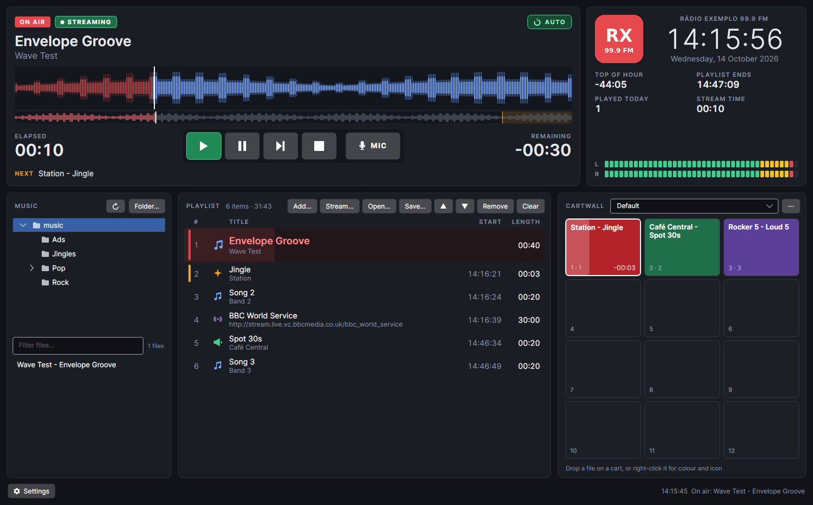

# Sintoniza Radio Broadcast system

A broadcast radio automation / playout app for **Linux, macOS and Windows**, with the same look on all three.
It is built in C# with [Avalonia](https://avaloniaui.net/) and uses the [BASS](https://www.un4seen.com/) audio
engine for decoding, mixing and streaming.



> **Status:** in development. It plays a playlist on air with crossfades, fires jingles from a cartwall, streams to
> Icecast/Shoutcast, sends now playing to an RDS encoder, keeps a music library and play history, and guards
> against dead air. Scheduling (hour templates and rotation) is next (see [Roadmap](#roadmap)).

## Features

- **On-air deck**: title and artist, the album cover (when the file has one), a scrolling waveform with a playhead, a full-track overview with the
  crossfade zone marked, elapsed/remaining time (turns red in the last 10 s), and the next item.
- **Transport**: Play, Pause, Next (crossfades straight away) and Stop. The button for the current state lights up,
  and Next flashes on every track change. The mode button switches between **AUTO**
  (runs through the playlist) and **ASSISTED** (stops after each item until you start the next).
- **Playlist**: drag and drop from the built-in music browser or your file manager, drag rows to reorder,
  estimated start time for each item, played/on-air/next markers, a type icon (music, jingle, commercial), and an
  on-air row that fills from left to right as the track plays. M3U open/save.
- **Internet streams in the playlist**: put another station's stream in the playlist (**Stream…**) for a set time
  (it crossfades into the next item when the time is up) or until you press Stop or Next. It connects a few seconds
  before it is due, so there is no dead air, and if the stream drops the playlist moves on. Saved with the playlist
  and in M3U files (`#EXTINF:-1` means until Stop).
- **Music library**: a database of the station's music, an SQLite file or a shared MySQL / MariaDB server
  (Settings → Library). The **LIBRARY** panel searches artist, title, album and file name as you type, ignoring
  case and accents, and filters by category: Current, Recurrent, Gold, Jingles, IDs, Promos, Ads, or your own
  (the ✎ button next to the filter adds, renames, recolours, orders and deletes categories).
  Right-click sets the category, tempo, voice and language of one or many songs. **Scan** adds new music and
  follows moved or renamed files, keeping their category, cue points and history. The app also scans by itself:
  a minute after it starts, every hour, and shortly after files in the music folders change (all adjustable in
  Settings → Library). Every item that goes on air is written to the play history. Studios sharing a MySQL
  library share categories, cue points and history. `radio-import` does the scanning from the command line. The
  tables are documented for other programs in [docs/library-database.md](docs/library-database.md).
- **Folders**: folder tree plus a filterable file list. Double-click to add, or right-click → *Play next*.
- **Cue points**: mark the usual radio markers on any file: **Cue In** (start), **Intro** (talk-over until the
  vocals), **Outro** (start of the ending), **Mix** (where the next item starts while this one finishes) and
  **Cue Out** (stop). Playback, lengths, start times and the waveforms follow them, and an INTRO / OUTRO countdown
  appears above the waveform for talking over. See [Cue points](#cue-points).
- **Tag editor**: right-click a playlist item or a file in the music browser → *Edit tags…* (Ctrl/Cmd+T) to
  change title, artist, album, genre, year, track number and comment, and to set or remove the cover picture
  (choose a JPEG/PNG or drop one on it). MP3s get ID3v2.3 tags; FLAC, OGG, M4A and WAV work too. The file on air
  can't be edited until it has finished playing.
- **Cartwall**: 12 instant buttons that play over the music, with a countdown and a progress fill while playing.
  Drop a file on a cart (from the music browser or the file manager) to assign it.
- **Station panel**: logo, station name, clock and date, countdown to the top of the hour, playlist end time,
  tracks played today, stream time, and stereo peak meters.
- **Streaming**: MP3 or OGG to Icecast 2 or Shoutcast v1, with "now playing" titles sent to the server.
  Click the STREAM button to start and stop (also while it is still connecting), or right-click it for Start / Stop;
  after an error a click retries and right-click → *Turn streaming off* clears it. It can also have a shortcut.
  One click on the **STREAM** badge next to ON AIR starts or stops it.
- **Separate outputs for the mixing desk**: music and cartwall can each go to their own sound card or output pair
  (Out 1–2, 3–4, …), so they come up on separate desk faders. A test tone helps you find which fader is which.
  The stream always carries music and cartwall together. A third output, **Preview**, is for pre-listening in the
  cue editor and is never streamed.
- **Web radio microphone**: set the station type to *Web radio* (Settings → Station) and a **MIC** button appears.
  Hold it (or F9) to talk: music and cartwall fade down to a set level and come back up when you let go. The mic
  goes into the stream only, not to the audio outputs, so you don't hear yourself with a delay; use headphones.
  The input, mic level, music level while talking and fade times are on the Microphone tab. With *FM radio* the
  mic goes through the mixing desk and there is no MIC button.
- **Top of the hour time signal** (Settings → Time signal): the pips (five short, the long one on the hour) or your own
  audio file, timed to end on the hour. Either play it **over** whatever is on air, or **stop** what is on air: it
  fades out just before the signal and the next playlist item starts right after it (in AUTO). Or turn it off.
  It plays on the Cartwall output and in the stream, and follows the computer's clock.
- **Settings** (Ctrl/Cmd+,): station name, logo, genre, website and station type, crossfade length, audio outputs,
  microphone, time signal, keyboard shortcuts and the streaming server.
- **Updates**: checks GitHub Releases at start and every 6 hours (can be turned off in Settings → About, which also
  has *Check now*). A new version shows a green *Update available* button; nothing is installed until you click
  it. Installed with the Windows setup or the .deb package, it downloads the package, checks its SHA-256 and
  installs it (Windows: the app closes and restarts on the new version; Linux: asks for the admin password, then
  offers a restart). Portable zip/tar copies open the download page instead.
- **RDS** (Settings → RDS): the radio text shows artist and title of the song on air (your own template, up to 64
  characters) and the station's text during jingles, adverts and when stopped; the PS is fixed. It is sent when
  the item changes and again every minute, so a restarted encoder catches up. Encoders are reached by TCP, UDP or
  a serial port, with **ASCII commands** (`RT=` / `PS=` by default, editable: PIRA32, P232, MRDS, DEVA and most
  others) or **UECP**; or the text is written to a file. *Send now* tests the connection.
- Remembers the playlist, carts and settings between runs.
- **Never off air** (Settings → Safety):
  - **Silence detection**: if nothing is heard for a set time (default 15 s under -45 dB) while an item plays, AUTO
    skips to the next item and a red SILENCE warning shows. After three silent items in a row it stops skipping
    and only warns, because the fault is then the sound card or the output rather than the files.
  - **Fill music**: when the playlist runs out in AUTO, songs are added from chosen library categories (not the
    same song within 3 hours or the same artist within an hour, the longest-rested first, using every studio's
    play history), or from a folder. With the library, the folder is the backup while the library can't be
    reached.
  - **Crash-safe**: settings and the playlist are saved every few seconds, written so that a power cut can't corrupt
    them (with a backup copy). After a crash, power cut or restart the app carries on with the item after the one
    that was on air, and turns streaming back on.
  - **Watchdog**: the app runs under a small supervisor process that starts it again if it crashes or its audio
    engine stops responding. Run with `--no-watchdog` to turn it off for one run.
  - **Start at login** (Windows, Linux, macOS). For an unattended studio computer, also turn on automatic login
    and turn off sleep.
  - **Stream reconnect**: a lost or refused connection to the streaming server is retried (5 s, 10 s, … up to every
    60 s) until you switch streaming off.
  - **Log**: what went on air, warnings, errors and restarts, one file a day in the `logs` folder next to the
    settings, kept for 90 days.

### Keyboard shortcuts

Play, Pause, Next, Stop, the mic, streaming on/off and each of the 12 carts can be given any key or combination in
**Settings → Shortcuts** (click a box, press the key). Cart keys play or stop the carts of the cartwall on screen,
and each cart shows its key in its corner. Plain keys don't fire while you type in a text box. The defaults:

| Key | Action |
| --- | --- |
| F5 / F6 / F7 / F8 | Play / Pause / Next / Stop |
| F9 (hold) | Microphone open, music ducked (web radio) |
| (none) | Stream on/off, carts 1–12 |

These are fixed:

| Key | Action |
| --- | --- |
| Ctrl/Cmd + O | Add files |
| Ctrl/Cmd + S | Save playlist |
| Ctrl/Cmd + E | Edit cue points of the selected item |
| Ctrl/Cmd + T | Edit tags of the selected item |
| Ctrl/Cmd + ↑ / ↓ | Move selected playlist items |
| Ctrl/Cmd + , | Settings |
| Delete | Remove selected items |
| Enter | Put the selected item on air |

### Item types

The type icon in the playlist comes from the folders a file is in:

| Folder name contains | Type |
| --- | --- |
| `jingles`, `ids`, `sweepers`, `stingers`, `vinhetas` | Jingle |
| `ads`, `spots`, `commercials`, `comerciais`, `publicidade` | Commercial |
| anything else | Music |

So `Music/Jingles/Station ID.mp3` is a jingle. This is a first version, and category rules in the music library
will replace it later.

### Cue points

Right-click a playlist item (or a file in the music browser) and choose **Edit cue points…**, or press Ctrl/Cmd+E.

| Marker | What it does |
| --- | --- |
| **Cue In** | Playback starts here, which skips silence or a count-in. |
| **Intro** | End of the intro. While it runs, a green **INTRO** countdown shows how long you can talk. |
| **Outro** | Start of the ending. From here a purple **OUTRO** countdown runs to Cue Out. |
| **Mix** | The next item starts here, and this one keeps playing unfaded until its Cue Out. Use it for songs that end on a hit or a long tail. With no Mix marker, the normal crossfade (Settings → Audio) applies. |
| **Cue Out** | Playback stops here, which cuts silence or a long fade at the end. In ASSISTED mode the deck stops here. |

In the editor, pre-listen on the **Preview** output (Settings → Audio). Click the waveform to jump, and use Space to
play or pause and ←/→ to move 1 s (hold Shift for 0.1 s). The mouse wheel zooms. **Set** puts a marker at the
playhead, ▶ plays from 3 s before it, and you can also type times such as `1:23.4`. **Auto-detect** sets Cue In
and Cue Out at the first and last sound, and Mix where a fade-out has died down.

Cue points are saved per file in the music library (your audio files are never modified), so studios sharing a
library share them: an edit in one studio reaches the others within half a minute. A file from outside the music
folders is added to the library for this. Each computer also keeps its own copy in `cues.json` next to the
settings, which is used while the library can't be reached. Cue points apply wherever the file is used, and
changes to the item on air take effect straight away.

> Give Preview its own output, such as the desk's PFL/cue input or a headphone card. If it shares an output with
> Music or Cartwall, the editor warns you that what you play will be heard on air.

## Building

### 1. Install the .NET 10 SDK

| OS | How |
| --- | --- |
| Windows | `winget install Microsoft.DotNet.SDK.10`, or the installer from <https://dotnet.microsoft.com/download> |
| macOS | `brew install --cask dotnet-sdk`, or the installer from <https://dotnet.microsoft.com/download> |
| Linux | Your distribution's `dotnet-sdk-10.0` package, or the install script:<br>`curl -sSL https://dot.net/v1/dotnet-install.sh \| bash -s -- --channel 10.0`<br>then `export PATH=$HOME/.dotnet:$PATH DOTNET_ROOT=$HOME/.dotnet` |

Check it with `dotnet --version` (it should print 10.x).

### 2. Download the BASS libraries

BASS isn't committed to the repository. Fetch it from un4seen.com with the script for your OS:

```bash
# macOS / Linux (fetches the libraries for the OS you're on)
./scripts/fetch-bass.sh

# Windows (PowerShell)
.\scripts\fetch-bass.ps1
```

They are saved to `native/linux-x64`, `native/osx` or `native/win-x64`. To build for another OS as well,
pass the platform: `./scripts/fetch-bass.sh win`, or `all` for all three. PowerShell uses
`-Platform win|osx|linux|all`.

### 3. Run it

```bash
dotnet run --project src/Playout.App
```

To try it without sound (BASS's "no sound" device), run `dotnet run --project src/Playout.App -- --device=0`.
This sends every output to that device and ignores the routing in Settings.

### 4. Make a release build

`./build.sh` builds ready-to-ship packages for Windows and Linux in `dist/` and fetches any missing BASS libraries
first: a `.zip` and a `-setup.exe` installer for Windows, and a `.tar.gz` and a `.deb` for Linux. The installer needs
NSIS (`sudo apt install nsis`); without it the script skips that step.

Use `./build.sh win` or `./build.sh linux` for one platform, and
`./build.sh all 1.0.0` to set the version (by default it comes from `git describe`).

To publish a GitHub Release, commit and push your changes, then run `./release.sh 1.0.0`. It builds all four packages,
tags the commit `v1.0.0` and uploads them to the repository's Releases page. It needs the
[GitHub CLI](https://cli.github.com/) (`sudo apt install gh`, then `gh auth login`).

To publish by hand instead, build a self-contained release, which needs no .NET installed on the target machine:

```bash
# Windows (64-bit)
dotnet publish src/Playout.App -c Release -r win-x64 --self-contained -o dist/win-x64

# macOS: Apple Silicon and Intel
dotnet publish src/Playout.App -c Release -r osx-arm64 --self-contained -o dist/osx-arm64
dotnet publish src/Playout.App -c Release -r osx-x64   --self-contained -o dist/osx-x64

# Linux (64-bit)
dotnet publish src/Playout.App -c Release -r linux-x64 --self-contained -o dist/linux-x64
```

You can publish for any OS from any OS, provided you have fetched that platform's BASS libraries (step 2).
The build copies the matching libraries into the output folder automatically.

Then start the app:

- **Windows:** `dist\win-x64\RadioPlayout.exe`
- **macOS:** `dist/osx-arm64/RadioPlayout`. The build is unsigned, so if macOS blocks it, run
  `xattr -dr com.apple.quarantine dist/osx-arm64` once. A proper `.app` bundle isn't produced yet.
- **Linux:** `dist/linux-x64/RadioPlayout`. Audio goes through ALSA, which works with PulseAudio and PipeWire.

## Project layout

```
src/Playout.Engine   Audio engine: BASS, main mixer, playlist automation, carts, streaming, waveforms.
                     Runs on its own thread; the UI only calls its public API.
src/Playout.Library  Music library database (SQLite / MySQL) and the folder scanner.
src/Playout.Import   radio-import: command-line library scanner.
src/Playout.App      Avalonia desktop UI (deck, playlist, music browser, cartwall, settings).
scripts/             fetch-bass.sh / fetch-bass.ps1: download the BASS native libraries.
native/<platform>/   BASS libraries (downloaded, not committed).
```

The engine never depends on the UI. Automation (auto-advance, crossfades) runs from BASS sync callbacks on the
engine thread, so a frozen window can't cause dead air.

Settings are stored in `settings.json` in the per-user app data folder:
`%APPDATA%\RadioPlayout` on Windows, `~/.config/RadioPlayout` on Linux, and `~/Library/Application Support/RadioPlayout` on macOS.

## Roadmap

- Auto cue (silence trimming) for files without cue points
- Hour templates, rotation rules (artist and title separation), jingles and IDs on a schedule
- Reports from the play history (royalties, advertisers)
- RT+ (artist and title tags in the radio text), live input switching and GPIO, voice tracking
- Loudness normalisation
- REST API for remote control

## Licensing

- **BASS** is free for non-commercial use. Commercial use, including running it at a commercial station or
  selling the software, needs a licence from [un4seen](https://www.un4seen.com/).
- **Avalonia** and **ManagedBass** are MIT licensed.
- **TagLib#** (tag editing, library scanning) is LGPL 2.1.
- **Microsoft.Data.Sqlite**, **MySqlConnector** and **System.IO.Ports** (RDS on a serial port) are MIT licensed,
  **Dapper** is Apache 2.0, and SQLite itself is public domain.
- The licence for this project's own code hasn't been chosen yet.
